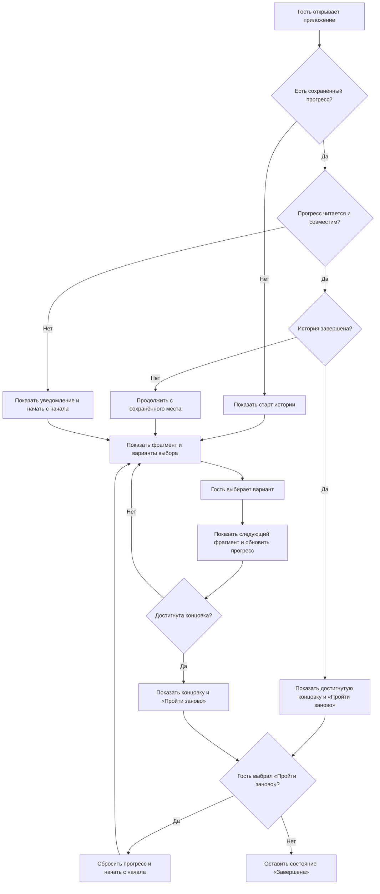
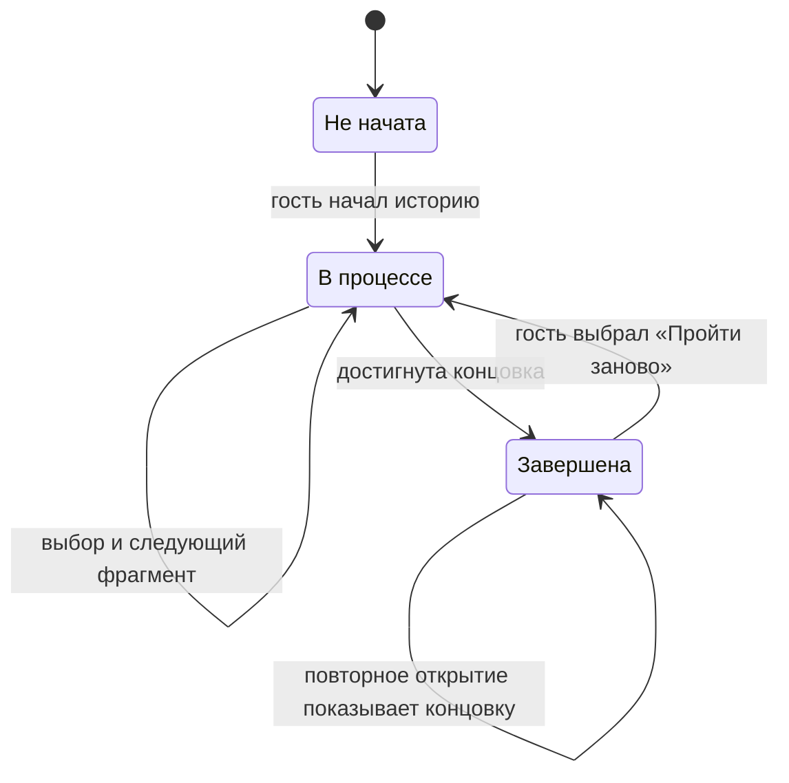

# Разбор истории: Гость проходит тестовую историю и продолжает её на том же устройстве

## История
- История: QUE-3 — Гость проходит тестовую историю и продолжает её на том же устройстве (432a7eda-1ca8-4289-9491-e50dd8939ec5)
- Требования фичи: FR-001 и FR-002 в SPEC-ID-001
- Решение о разбиении: FR-001 и FR-002 образуют один вертикальный срез; FR-002 без FR-001 не имеет самостоятельной ценности, поэтому Feature представлена одной User Story
- Контент истории: `docs/artifacts/content/QUE-BUNDLED-001-kniga-kotoruyu-nikto-ne-otkryval.md`
- Решения Project Owner от 2026-11-22: `docs/decisions/2026-11-22-bundled-test-story-content.md`, `2026-11-22-behavior-after-ending.md`, `2026-11-22-corrupt-progress-behavior.md`, `2026-11-22-nfr-and-target-platforms.md`, `2026-11-22-product-metric-deferred.md`, `2026-11-22-no-public-launch.md`

## Участники
| Участник | Роль в сценарии | Что делает |
|---|---|---|
| Гость | Пользователь без регистрации | Открывает приложение, начинает встроенную историю, выбирает варианты, достигает концовки, прерывает и возобновляет прохождение на той же установке |
| Приложение QuestBook.today | Клиентская часть продукта | Показывает встроенную историю и варианты выбора, фиксирует выбор, сохраняет и читает локальный прогресс, показывает концовку и действие «Пройти заново» |
| Локальное хранилище устройства | Место хранения прогресса | Хранит прогресс и состояние прохождения между запусками приложения на той же установке |

## Основной сценарий
1. Гость открывает приложение → доступна одна встроенная тестовая история без регистрации.
2. Гость начинает историю → показывается стартовый фрагмент QUE-BUNDLED-001 и два варианта выбора.
3. Гость выбирает вариант → показывается фрагмент выбранной ветки, а прогресс обновляется.
4. Гость проходит ветку до концовки → показывается концовка в варианте текста, соответствующем выбранной ветке, и действие «Пройти заново».
5. Гость закрывает приложение → прогресс сохраняется локально на этой установке; для завершённой истории сохраняется состояние «Завершена».
6. Гость повторно открывает приложение на той же установке → доступно продолжение с сохранённого места; после концовки показывается достигнутая концовка и действие «Пройти заново».
7. Гость выбирает «Пройти заново» → прогресс сбрасывается, история начинается с узла start.

## Альтернативные потоки и исключения
| Условие | Поведение | Итог |
|---|---|---|
| Гость ещё не начинал историю; сохранённого прогресса нет | Приложение предлагает начать встроенную тестовую историю | Доступен старт с начала |
| Гость прервал прохождение, не дойдя до концовки | Прогресс сохранён на устройстве; при повторном открытии доступно продолжение | Прохождение продолжается с сохранённого места |
| Гость достиг концовки | Показывается достигнутая концовка в варианте текста по выбранной ветке и действие «Пройти заново»; автоматический старт не выполняется | История завершена; повторный старт доступен по действию гостя |
| Гость выбрал «Пройти заново» | Прогресс сбрасывается в начало истории; показывается стартовый фрагмент | Новое прохождение начинается с начала |
| Гость открывает приложение на другой установке | Доступен только прогресс этой установки; перенос и синхронизация не входят в срез | На другой установке доступен старт; прогресс первой установки не переносится |
| Гость пытается зарегистрироваться или синхронизировать прогресс | Сценарий первого среза не содержит регистрации и межустройственной синхронизации | Действие вне рамок истории |
| Сохранённый прогресс недоступен, повреждён или несовместим | Приложение начинает историю с начала и явно уведомляет: «Не удалось восстановить сохранённый прогресс. История начнётся заново.»; непригодная запись сбрасывается | Гость может начать заново; частичные данные не используются |

## Бизнес-правила
| Правило | Формулировка | Тип | Источник |
|---|---|---|---|
| Без регистрации | Гостевой старт и прохождение истории не требуют регистрации или учётной записи | ограничение | FR-001, AC-1, AC-3 в SPEC-ID-001 |
| Одна история | В первом срезе гость может пройти одну встроенную тестовую историю | ограничение | FR-001 в SPEC-ID-001 |
| Влияние выбора | Выбранный вариант определяет последующий фрагмент истории и достигнутую концовку | вывод | FR-001, AC-1 в SPEC-ID-001 |
| Достижимая концовка | Из доступных веток достижима концовка | ограничение | FR-001, AC-1 в SPEC-ID-001 |
| Локальный прогресс | Прогресс сохраняется локально на установке и доступен после повторного открытия приложения | ограничение | FR-002, AC-2 в SPEC-ID-001 |
| Продолжение без регистрации | Продолжение с сохранённого прогресса не требует регистрации | ограничение | FR-002, AC-2 в SPEC-ID-001 |
| Только та же установка | Прогресс не переносится на другую установку и не синхронизируется между устройствами | ограничение | AC-3 в SPEC-ID-001 |
| Границы первого среза | Сценарий не включает платежи, выплаты авторам и публичный запуск | ограничение | AC-3 в SPEC-ID-001 |
| Показ концовки | После достижения концовки показывается концовка в варианте текста, соответствующем выбранной ветке, и действие «Пройти заново» | триггер | Решение 2026-11-22-behavior-after-ending |
| Повторный старт | Повторное прохождение начинается только по явному действию гостя «Пройти заново» и сбрасывает прогресс в начало истории; автоматически история не начинается | триггер | Решение 2026-11-22-behavior-after-ending |
| Повреждённый прогресс | Если локальный прогресс недоступен, повреждён или несовместим, приложение начинает историю с начала и явно уведомляет гостя; непригодная запись сбрасывается | триггер | Решение 2026-11-22-corrupt-progress-behavior |
| Фиксированный контент | Встроенная тестовая история — QUE-BUNDLED-001: три фрагмента, одно ветвление с двумя вариантами и одна концовка с двумя вариантами текста | ограничение | Решение 2026-11-22-bundled-test-story-content |
| Без коммерческих обещаний | Коммерческие обещания, цены, платежи и выплаты авторам не входят в срез до появления и приёмки рыночных и коммерческих артефактов | ограничение | Решение 2026-11-22-no-public-launch |

## Данные
| Что читаем | Что пишем | Формат |
|---|---|---|
| Встроенную тестовую историю QUE-BUNDLED-001: три фрагмента, одно ветвление с двумя вариантами, одна концовка с двумя вариантами текста | — | Только текст; источник — docs/artifacts/content/QUE-BUNDLED-001-kniga-kotoruyu-nikto-ne-otkryval.md; технический формат не определён |
| Сохранённый локальный прогресс: состояние «В процессе» или «Завершена», место в истории, сделанные выборы и признак совместимости | Локальный прогресс при старте, выборе, достижении концовки и повторном старте; сброс непригодной записи | Бизнес-уровень; технический формат, версионирование и признак совместимости — решение SA |

## Системы и интеграции
| Система | Что делает в сценарии | С чем обменивается |
|---|---|---|
| Приложение QuestBook.today | Показывает встроенную историю и варианты выбора, принимает выбор, сохраняет и читает локальный прогресс, показывает концовку и действие «Пройти заново» | С локальным хранилищем устройства; внешних систем нет |
| Локальное хранилище устройства | Хранит прогресс и состояние прохождения между запусками приложения на той же установке | С приложением QuestBook.today; сетевого обмена нет |

## Нефункциональные требования
—

## Диаграммы

## Открытые вопросы
1. **Содержание встроенной тестовой истории — решено.** Project Owner утвердил QUE-BUNDLED-001 «Книга, которую никто не открывал»: три фрагмента, одно ветвление с двумя вариантами, одна концовка с двумя вариантами текста. Решение: `docs/decisions/2026-11-22-bundled-test-story-content.md`; контент перенесён в документ истории и спецификацию.
2. **Поведение после достижения концовки — решено.** Показывать достигнутую концовку и действие «Пройти заново»; повторный старт только по действию гостя и сбрасывает прогресс. Решение: `docs/decisions/2026-11-22-behavior-after-ending.md`.
3. **Поведение при недоступном, повреждённом или несовместимом прогрессе — решено.** Начинать историю с начала с уведомлением «Не удалось восстановить сохранённый прогресс. История начнётся заново.»; непригодную запись сбрасывать. Решение: `docs/decisions/2026-11-22-corrupt-progress-behavior.md`.
4. **Численные NFR и целевые платформы — открыто, блокирует перевод Feature в todo.** Пороги и платформы задаёт владелец требований до начала разработки; значения не выдумываются. Кандидатные характеристики: время до первого фрагмента, время перехода между фрагментами, сохранность прогресса после перезапуска, совместимость при смене версии, работа без сети. Решение: `docs/decisions/2026-11-22-nfr-and-target-platforms.md`.
5. **Продуктовая метрика — открыто, срез не блокирует.** Baseline, target, источник и владелец не назначаются до появления `business-case.md`; кандидат «доля гостей, завершивших историю после начала» остаётся кандидатом. Решение: `docs/decisions/2026-11-22-product-metric-deferred.md`.
6. **Коммерческие артефакты Epic — открыто, вне среза.** Публичный запуск, коммерческие обещания, цены, платежи и выплаты авторам не разрешены до появления и приёмки `market.md`, `business-case.md`, `pricing.md` и `gtm.md`. Решение: `docs/decisions/2026-11-22-no-public-launch.md`.
7. **Технический формат и механизм локального хранения — открыто для SA.** Формат, версионирование, признак совместимости и обнаружение повреждения не определены; это решение SA, а не требование BA.
8. **Критерии приёмки — предложены BA, утверждает QA.** Предложения AC-1…AC-5 находятся в документе истории и спецификации; в запись истории их вносит QA.
