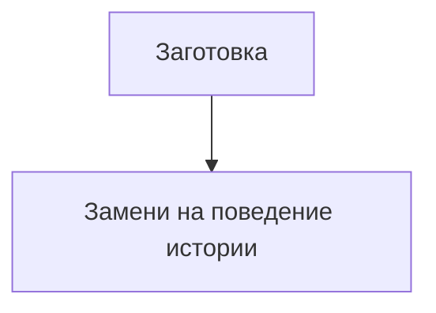

# Разбор истории: Гость проходит тестовую историю и продолжает её на том же устройстве

## История
- История: QUE-3 — Гость проходит тестовую историю и продолжает её на том же устройстве (432a7eda-1ca8-4289-9491-e50dd8939ec5)

## Участники
<!-- | Участник | Роль в сценарии | Что делает | -->

## Основной сценарий
<!-- 1. шаг → результат (не меньше двух шагов) -->

## Альтернативные потоки и исключения
<!-- | Условие | Поведение | Итог | -->

## Бизнес-правила
<!-- | Правило | Формулировка | Тип | Источник | -->

## Данные
<!-- | Что читаем | Что пишем | Формат | -->

## Системы и интеграции
<!-- | Система | Что делает в сценарии | С чем обменивается | -->

## Нефункциональные требования
<!-- | Характеристика | Метрика | Порог | Условия | Как проверяется | -->

## Диаграммы

## Открытые вопросы
<!-- вопросы к человеку или «нет» -->
